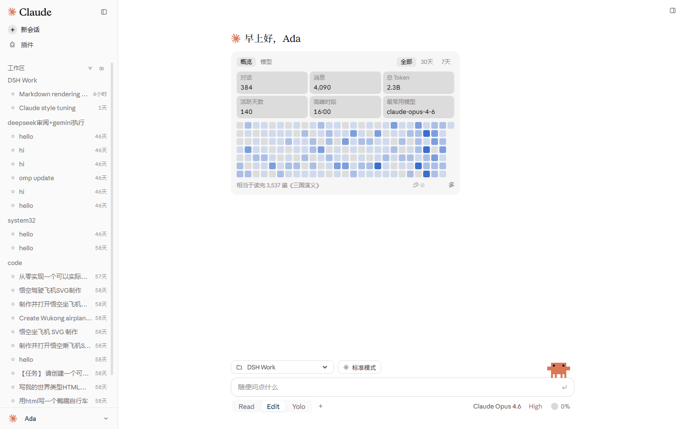
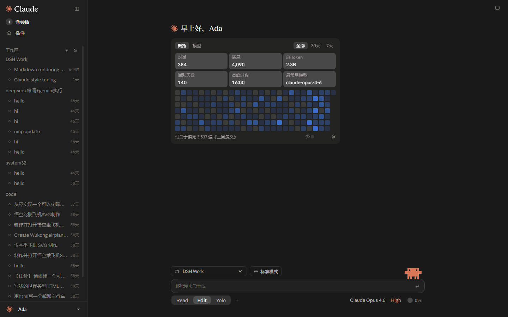
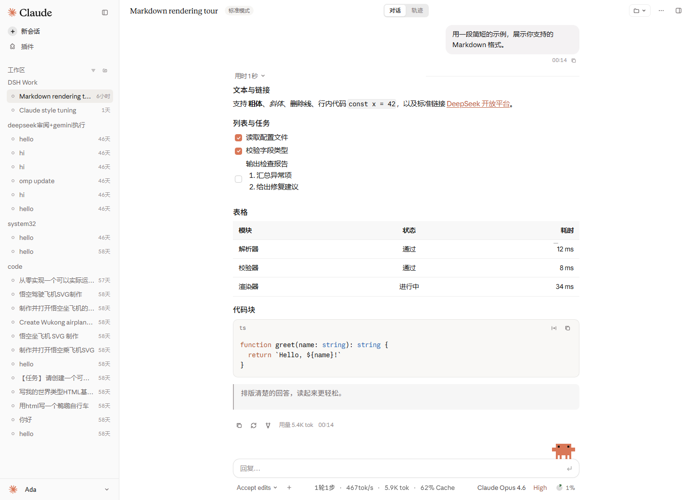
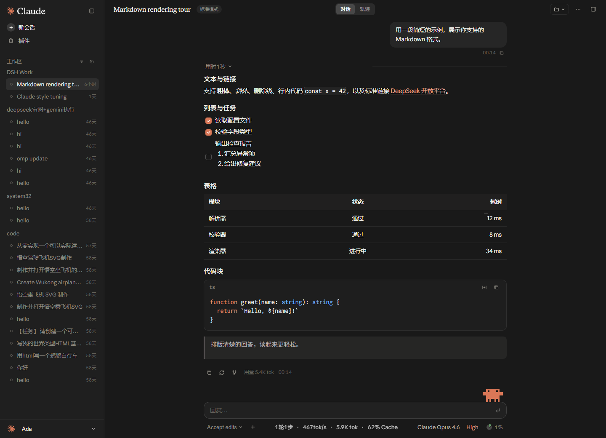
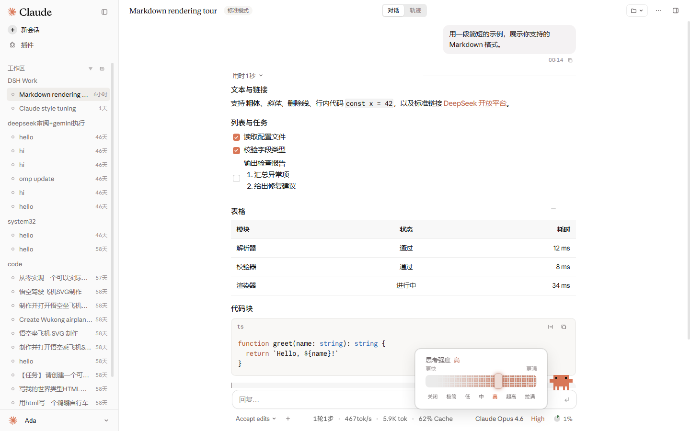
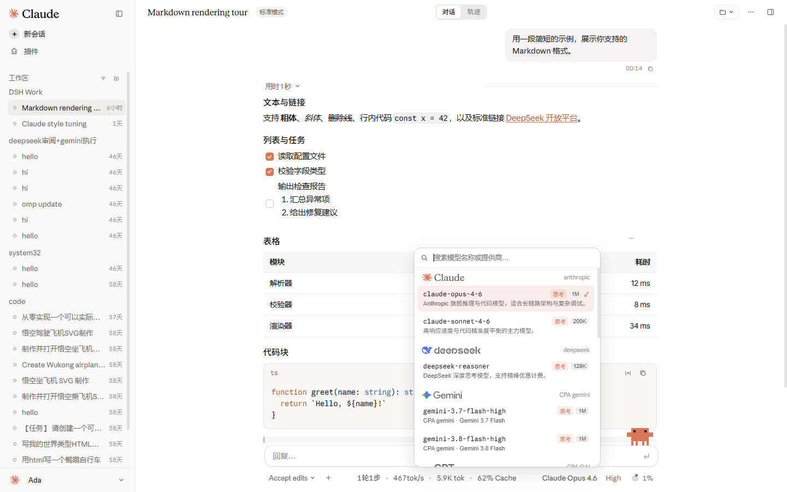
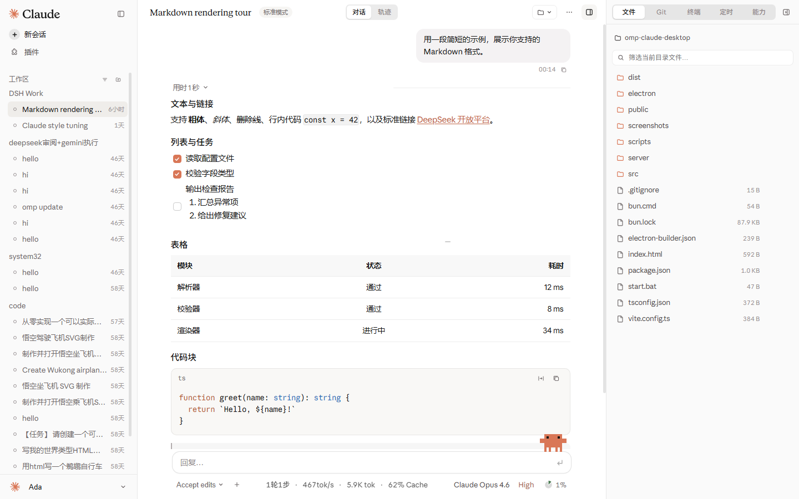
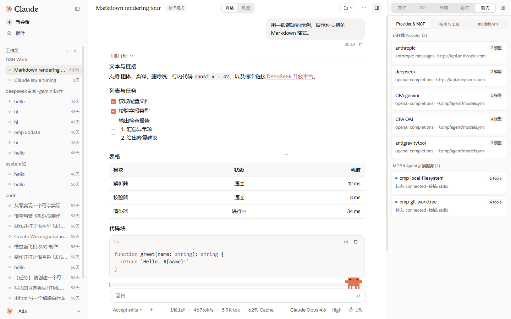

# OMP Claude Desktop (`omp-claude-desktop`)

基于 [Nwflower/dsh-claude-style](https://github.com/Nwflower/dsh-claude-style) 1:1 视觉与交互规范打造的高性能 **Oh-My-Pi (OMP)** 桌面客户端，深度融合 Pi Desktop 生态（GooeyPi / pi-agent-desktop / apoc-omp-desktop）与 DeepSeek Harness (DSH) 研发工作台能力。

---

## 核心界面预览

| Studio 首页（浅色） | Studio 首页（深色） |
| --- | --- |
|  |  |

| 对话与代码高亮（浅色） | 对话与代码高亮（深色） |
| --- | --- |
|  |  |

| 思考强度点阵滑轨 (`EffortPicker`) | 26 家厂商彩色品牌锁扣 (`ModelPicker`) |
| --- | --- |
|  |  |

| 右侧研发工作台（文件树与引用） | 右侧研发工作台（OMP 能力与 MCP） |
| --- | --- |
|  |  |

---

## 核心特性

1. **100% 原汁原味 `dsh-claude-style` 现代 UI 规范**
   - **单行胶囊输入栏 + 画布底栏分离布局**：输入框内部右侧内嵌 `↵` 发送键与运行态墨色圆环停止键；输入框下方画布直接承载 `Read | Edit | Yolo` 分段胶片（首页）或 `Accept edits ⌄`（会话内）、`+` 工作台菜单、实时吞吐遥测（`1轮1步 · 467tok/s · 5.9K tok · 62% Cache`）、无边框模型/思考强度触发器与 `◔` 裂隙饼图上下文仪表。
   - **原版左侧边栏**：顶部太阳花图形标 + `Claude` 字标并排、`+ 新会话` 圆片旋转动效、无冗余文件夹图标的清爽项目分组、`6px` 空心圆点会话列表与相对时间戳、底部 `0.5px` 分割线 `Ada` 账户栏。
   - **原版思考强度滑轨 (`EffortPicker`)**：`26px` 凹槽轨道、`16×30px` 纵向圆角白滑块与内置 5 行设备像素级呼吸流动粒子点阵（`solveMatrix` + `flowStrength`）。
2. **多会话零阻塞架构 (`Bun + Electron`)**
   - 直接读取并管理 `~/.omp/agent/sessions/**/*.jsonl` 与 `~/.omp/agent/models.yml`，支持 Tail-50 首屏秒开（`< 2ms`）、160ms 悬停预热与 Keep-Alive 会话池。
3. **内置右侧研发工作台 (`Workbench Dock`)**
   - **文件**：工作区目录浏览、筛选、代码预览与一键 `@file` 引用插入。
   - **Git**：分支状态、变更行统计（`+added / -deleted`）、Stage / Unstage / Commit 与 Unified Diff 预览。
   - **终端**：工作区内置 PowerShell 交互终端与快捷命令胶片。
   - **定时**：DSH 风格自动化巡检定时任务管理与立即运行。
   - **能力**：实时解析 `~/.omp/agent/models.yml` Provider 渠道、MCP 服务、Slash 指令与内置工具。

---

## 快速启动

```powershell
# 启动开发模式（自动拉起 Bun 后端 + Vite + Electron 桌面窗口）
bun run start

# 仅构建前端产物
bun run build
```
